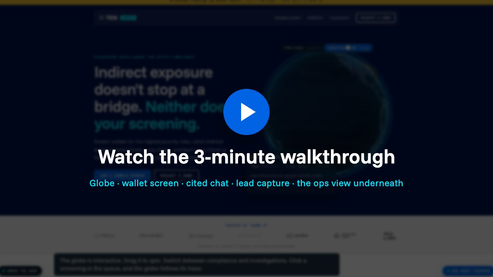

# Crypto compliance demo page: concept redesign

A concept redesign of TRM Labs' `/crypto-business/demo` page by Elbert Ballo. **Not a TRM page.** The page says so at the top and the bottom, and it is marked `noindex,nofollow`. All wallets, scores and leads are made up.

- **Live page:** https://elbertballodev.github.io/trm-demo-page-concept/
- **Walkthrough video (3 min):** https://elbertballodev.github.io/trm-demo-page-concept/walkthrough/walkthrough.mp4

What to try on the live page:
1. Drag the globe, switch **Compliance / Investigations**, click a row in the queue.
2. **Screen a wallet:** pick a sample wallet, then open **Configure risk rules** and turn a rule off.
3. **Ask about coverage** (bottom right): ask a question, then click **Talk to a specialist**.
4. **Under the hood** (bottom left): Events, CRM record, MQL score, Routing, Outbox, Chat QA.

The page runs offline in the browser. Nothing is sent anywhere unless live mode is set up (`sheet/SETUP.md`).

## Versions

- `index.html` + `style.css`: the current skin in TRM's design language (2026-10-26). Navy hero `#00124d`, ink `#071c2c`, blue `#0063e4`, cyan `#06e4f9`, off-white `#f7f5f4`, mono caps buttons with 8 px corners. The hex values and type roles were read from trmlabs.com's own stylesheet. TRM Sans and TRM Sans Mono are proprietary, so the page uses **Funnel Sans** and **Space Mono** (both OFL, and both also loaded on trmlabs.com). The hero visual is a live 3D globe (see below); there are no photos.
- The first, editorial-collage skin and the dev copies are in `_archive/`. They are not linked from the page, and their relative paths no longer resolve.

## What's on the page (v3)

- **Hero globe** (`globe.js`): Elbert's own globe from `~/Projects/trm-globe-demo` (three.js, NASA Blue Marble / Black Marble textures and Natural Earth borders, embedded in `vendor/`). It shows:
  - A dense, regionally balanced network: ~280 points and ~120 faint arcs, no arc under ~800 km, travelling pulses.
  - Up to 4 made-up screenings at once, each with its own lifecycle. They spawn where the globe is facing.
  - A **Compliance (prevent) | Investigations (trace)** toggle, also settable with `?mode=compliance|investigate`.
  - A live queue card. Click a row or a chip to focus that trace.
  - Rotation as one continuous orientation (about 3°/s, never reset). It opens on the Gulf / Indian Ocean.
  - Rendering pauses off-screen. With reduced motion, it shows static drawn traces.
- **Wallet screen** (`widget.js`): an investigation panel with chain lanes, a fund-flow graph (hover for a tooltip, click to pin a path), a typed step log, a risk gauge, findings with confidence bars, a results bar (Block / Escalate / Export are demo only) and **Configure risk rules** toggles that re-score live. It is drawn as a pure function of time (`paintAt(t)`), so the HyperFrames film uses the same code.
- **Walkthrough film**:
  - Files: `assets/video/widget-walkthrough.mp4` (1920×1080, 30 fps, 14 s, silent) and `-poster.jpg`. The square render is in `_archive/assets/video/`.
  - Built in HyperFrames: `film/` (landscape) and `film-square/` (square). To re-render, run `npx hyperframes render -o ../assets/video/<name>.mp4 -q delivery` in each folder.
  - On the page it is the widget's preview: muted, looped and paused off-screen, with the poster only under reduced motion. Clicking a wallet or **Run it live** swaps in the live panel.
- **Customer logos**, the **"What our customers say\*"** stats band (wording exactly as on TRM's page; the asterisk has no footnote there, so the page says so) and **"Built by industry experts"** (titles and prior roles exactly as on TRM's page, with monogram avatars, not photos).

## Concept assistant (A/B test next to the form)

TRM's site has no chat widget, so this is a proposal. It sits **next to** the form and never replaces it.
- **A/B:** on by default for the demo. `?chat=off` hides it (variant A: form only). `?chat=ab` runs the real 50/50 split, remembered per browser.
- **Capture flow:** the **Talk to a specialist** chip (or **Ask me here** after two product questions) asks the form's questions one at a time and writes each answer into the real form. The form is submitted only when the visitor clicks **Yes, contact me**. Victim words or a seed phrase stop the flow; "stop" cancels it. Analytics gets field names only.
- **Offline outbox:** consented, non-victim leads from the form or the chat are saved in this browser (`localStorage`, key `concept_outbox`). **Under the hood → Outbox** lists them, downloads a CSV, and in live mode sends them to the Sheet. Every row carries `capture_source` (`form` or `chat`), so the two paths can be compared.
- **Offline (default):** `kb.js` holds 33 short excerpts quoted or closely paraphrased from TRM's public pages (crypto-business demo, Ardence, Forensics, the Crypto Compliance pages, the impersonation-scam warning, the Roxom and HIFI case studies, the Beyond Fentanyl summary), each with its source URL. `chatcore.js` scores them with BM25 and answers only by quoting the top excerpts, each with a numbered citation chip that opens the source. Below the score threshold it says "I don't have an approved answer for that" and offers a specialist.
- **Chain counts stay tied to their page:** Forensics says 65+ blockchains; the crypto-business, Wallet Screening and Compliance pages say 184+.
- **Guards, before any retrieval:** scam victims get a fixed reply (TRM's own wording that it "is not involved in fund recovery processes for victims", ic3.gov, the impersonation warning), with no sales handoff. Seed phrases and private keys are redacted before they are shown, logged or sent, with a warning. Pricing and legal questions get a fixed refusal.
- **Handoff:** after "book a demo" / "talk to sales", or two product questions, it offers **Ask me here** (the capture flow below) or **Prefill the form** (need, and company if stated; the visitor checks the fields and ticks consent). The assistant never submits on its own.
- **Live (optional):** `?live=<script.google.com URL>&chat=live` sends questions to the Apps Script chat route (Claude Sonnet 5.5, key in Script Properties). The server sends Claude only the retrieved excerpts and blocks any reply where a sentence lacks a valid [n]; the page checks again. See `sheet/SETUP.md`.
- **Instrumentation (no message text):** `chat_open`, `chat_question` (intent category), `chat_answer` (chunk ids, grounded), `chat_fallback`, `chat_handoff`, `victim_support`, `chat_secret_redacted`, `ungrounded_answer_blocked`. Under the hood → **Chat QA** shows each answer's retrieved chunk ids, scores and grounding result.

## Open it

Double-click `index.html`. It needs no server or build step, and it works offline (fonts and images are local).

Useful URLs:
- `index.html?v=a` or `?v=b`: force the hero headline variant (A/B test, like TRM's own `/lp/epco-framework-a` and `-b`).
- `index.html?utm_source=linkedin&utm_medium=paid_social&utm_campaign=crypto-compliance-q4`: the hidden UTM fields fill from the URL.
- Press **⚙ Under the hood** (bottom right) to see events, the CRM record, the MQL score, routing, enrichment and the tracking setup.

## Demo mode and live mode

**Demo mode is the default.** Nothing leaves the browser. The panel shows what a real submit would create.

**Live mode** sends consented submissions to a Google Sheet through a Google Apps Script web app. The Sheet and the Apps Script are built separately; this page only has the client hook.

- Set it at the top of `app.js`: `const LIVE_ENDPOINT = 'https://script.google.com/macros/s/<deployment-id>/exec';`
- Or test without editing: `index.html?live=<url-encoded Apps Script URL>`.
- Only `https://script.google.com/...` URLs are accepted, from both the constant and `?live=`, so a crafted link can't send form data to another host.
- On submit the page POSTs the record as JSON with `Content-Type: text/plain` and `mode: 'no-cors'`. Apps Script web apps accept this without a CORS preflight. The fields are: the form fields, UTMs, `sfdcCampaignId`, the A/B variant, the score and its rows, status, routing, consent, timestamp, page URL, and the HubSpot and Salesforce records.
- The response is opaque (no-cors), so "Sent to sheet ✓" in the event log means the request left the browser. Check the Sheet to confirm the row.
- **Rules:**
  - It never sends without consent.
  - It never sends victim-flagged submissions (need = "I lost funds to a scam or theft", or victim words in the message). These are logged as `victim_support` in the event log only.
  - It never sends spam-pattern emails.
- When live, the page copy changes from "demo mode" to "live mode", and the consent text says answers are saved to a Google Sheet.

## What is real and what is made up

**Real, from TRM's public pages, quoted or tightened from how they appear there:**
- From `trmlabs.com/crypto-business/demo`:
  - The 3 solution areas and their bullets.
  - Sanctions coverage on 184+ blockchains, 1.9 billion assets covered, 150+ risk indicators.
  - Cross-chain bridge tracing, and source details and confidence levels.
  - The customer list and its logos (see Logos below).
  - The survey results 91%, 85% and 83%, with TRM's exact wording.
  - The three experts' names, titles and prior roles.
- The 92% stat is left out. TRM's page marks it with an asterisk but shows no footnote.
- Roxom case study (`trmlabs.com/files/case-study-how-roxom-is-pioneering-agentic-compliance`):
  - A seven-agent anti-money laundering investigation swarm, built in a week.
  - "more AI agents than people", with a person deciding every outcome.
- HIFI case study (`trmlabs.com/files/case-study-how-hifi-built-compliance-into-stablecoin-infrastructure-from-day-zero`):
  - Two weeks to implement support for new blockchains, on average.
  - Arya Demehri, compliance lead: "one of the key inputs underpinning our entire transaction monitoring operation."
- The victim note links to TRM's impersonation scam warning (`/policies/impersonation-scam-warning`) and to ic3.gov.

**Made up (labeled on the page):**
- The 3 sample wallets, their graphs, amounts, timestamps, findings, sources, confidence and risk.
- Every wallet, case, city route and status on the globe.
- The scoring rules, threshold, routing, SLA targets and enrichment steps (`definitions.js`).
- The Salesforce campaign ID `701XXXXXXXXDEMO01`. TRM's real pages carry IDs that start with 701.
- CRM field names other than `services_of_interest__c`, which appears on TRM's public form.

## Files

- `index.html`: the page.
- `style.css`: the TRM-language skin.
- `definitions.js`: the single source of truth for exclusions, scoring, routing and CRM values. The form, score, routing and record all read it, mirroring `../workflows/definitions.yaml`.
- `app.js`: the form, dataLayer events, under-the-hood panel, wallet picker, walkthrough preview and live-mode hook.
- `kb.js`, `chatcore.js`, `chat.js`: the concept assistant (knowledge base, guards + retrieval + grounding check, UI). `sheet/KB.gs` and `sheet/ChatCore.gs` are copies for the Apps Script.
- `widget.js`: the investigation panel. `globe.js`: the hero globe.
- `vendor/`: three.js (MIT), topojson-client (ISC), Natural Earth 50m countries (public domain), NASA textures (public domain), copied from trm-globe-demo.
- `assets/`:
  - Fonts: Funnel Sans and Space Mono (OFL).
  - The TRM Labs logo SVG and the customer logos.
  - The collage skin's fonts and photos moved to `_archive/assets/`; their sources are listed in `../ardence-collage/CREDITS.md`.
- `screenshots/`: headless test captures (desktop and 390 px mobile).

## Logos

The seven customer logos are the SVG files that TRM's own `/crypto-business/demo` page loads (the last-resort source in the brief). Simple Icons only has Circle and Binance, and only as symbol marks without wordmarks, so mixing sources would have given an uneven row. The marks are not edited; CSS shows them in grayscale at 72% opacity and in full colour on hover.

- Circle: https://cdn.prod.website-files.com/6082dc5b67056233213587a4/6740cf046b9c928eb83adedf_circle%20logo.svg
- FalconX: https://cdn.prod.website-files.com/6082dc5b67056233213587a4/6740cf053c3e05cc9050263f_falconx%20logo.svg
- Uniswap: https://cdn.prod.website-files.com/6082dc5b67056233213587a4/6740cf04214b624ea0224440_uniswap%20logo.svg
- Binance: https://cdn.prod.website-files.com/6082dc5b67056233213587a4/6740cf04178ca0c0a0a6c1cf_binance%20logo.svg
- Sardine: https://cdn.prod.website-files.com/6082dc5b67056233213587a4/6740cf04587b9f23927f867a_sardine%20logo.svg
- Anchorage Digital: https://cdn.prod.website-files.com/6082dc5b67056233213587a4/6740cf044a6316daddc67fd0_anchorage%20digital%20logo.svg
- Ava Labs: https://cdn.prod.website-files.com/6082dc5b67056233213587a4/6740cf06bfe53d70c6bf8f09_avalabs%20logo.svg

**Third-party logos are trademarks of their owners.** This page is an interview concept. Keep it private and unlisted (it is `noindex`), and do not publish it publicly.

## Privacy

Analytics events carry field names only, never personal data. In live mode the Sheet receives what the person typed, but only with consent.
