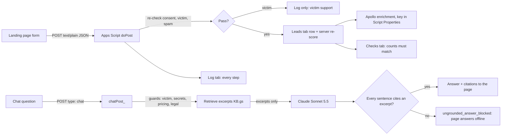

# Landing page → Google Sheet → Apollo: setup

Made-up demo for an interview concept. Use only your own email and test entries. No real prospects.

## Steps (about 10 minutes)

1. Create a blank Google Sheet in the account you want to own it. Name it "TRM concept leads".
2. Open **Extensions → Apps Script**. Delete the sample code. Paste all of `Code.gs`. Save.
   For the chat route, add two more script files with **+ → Script**: `KB` (paste `KB.gs`) and `ChatCore` (paste `ChatCore.gs`). They are copies of `../kb.js` and `../chatcore.js`; when you change those, copy them again (`cp ../kb.js KB.gs && cp ../chatcore.js ChatCore.gs`).
3. In the editor, pick `setup` in the function menu and click **Run**. Approve the permissions prompt (it asks to edit this Sheet and connect to an external service). Check that the Sheet now has the tabs Leads, Log and Checks.
4. Optional, enrichment: **Project Settings → Script Properties → Add**: name `APOLLO_API_KEY`, value = your Apollo API key. Each enrichment uses Apollo credits. Without the key, rows still arrive and say "skipped: no APOLLO_API_KEY".
   Optional, live chat: add `ANTHROPIC_API_KEY` the same way (Script Properties, never in a file or the page). The chat route calls Claude Sonnet 5.5 (`claude-sonnet-5-5`) at low effort with short answers; each question costs a small amount of API usage, and the script allows 30 chat requests a minute. Without the key, chat answers offline from the same excerpts.
5. **Deploy → New deployment → type Web app**. Execute as: **Me**. Who has access: **Anyone**. Click Deploy and copy the web app URL (`https://script.google.com/macros/s/…/exec`).
6. Test without changing any code: open
   `landing-redesign/index.html?live=<web app URL>`
   and submit the form with your own work email and consent checked.
   Live chat test: open `landing-redesign/index.html?live=<web app URL>&chat=live`, open **Ask about coverage** and ask "Which chains do you cover?". The footer says "Live · Claude Sonnet 5.5", the answer has numbered citations, and the Log tab shows `chat_answer`. Under the hood → **Chat QA** shows the retrieved chunk ids, scores and the grounding check.
7. Check the Sheet:
   - **Leads** has one new row with `server_score` and `score_match = TRUE`.
   - **Log** shows `row_added` (and `enriched` if you added the key).
   - **Checks** shows "Rows without consent = 0 ✓" and "score mismatches = 0 ✓".
8. To make live mode the default, set `LIVE_ENDPOINT` at the top of `app.js` to the URL.

## Tests to run

| Submit | Expected in the Sheet |
|---|---|
| Your work email, Head of Compliance, Transaction monitoring | Leads row, status `mql`, score match TRUE |
| Same email again | New row with `duplicate_of_row` = first row |
| A gmail address | Status `lead`, reason "free email", enrichment "skipped: free email" |
| Need = victim, or a message with "scammed" | No Leads row. Log says `victim_support` (the page doesn't even send it) |

| Chat question | Expected |
|---|---|
| Chat: "Which chains do you cover?" (live) | Log `chat_answer`, grounded |
| Chat: "I was scammed, can you help?" | Log `victim_support`; the model is not called; no sales handoff |
| Chat: a pasted seed phrase or private key | Redacted on the page before sending; Log `chat_secret_redacted` if it reaches the server; the model is not called |

## Notes

- Chat grounding: the server sends Claude only the retrieved excerpts, numbered. It then checks that every sentence of the reply cites [n] for an excerpt it sent. If one doesn't, the reply is replaced (Log `ungrounded_answer_blocked`) and the page answers offline. The page runs the same check again before it shows a live answer.
- Chat request: `anthropic-version: 2026-10-21`, `output_config.effort: "low"`, and `fallbacks: "default"` with the `server-side-fallback-2026-07-01` beta header, so a safeguard decline is retried on a fallback model inside the same call. A `refusal` or `max_tokens` stop falls back to the offline answer.

- The web app URL is public by design. A form endpoint is reachable by anyone who has the URL. The script re-checks every rule server-side and limits posts to 20 a minute.
- The server re-scores every lead with its own copy of the rules. If someone edits `definitions.js` but not `Code.gs`, the Checks tab shows the mismatch. That's the "dashboards can't quietly disagree" idea in miniature.
- The Apollo endpoint and fields (`/api/v1/people/match`, `person.title`, `seniority`, `linkedin_url`, `organization.estimated_num_employees`) need checking against Apollo's current API docs before relying on them.
- Change a deployment: **Deploy → Manage deployments → Edit → New version**. The URL stays the same.
